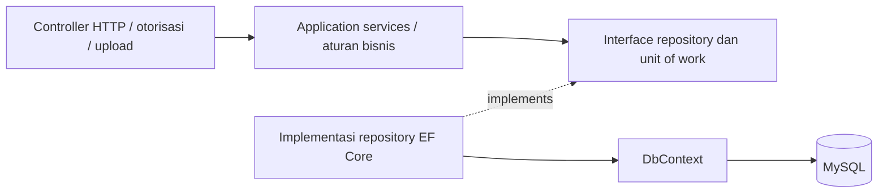
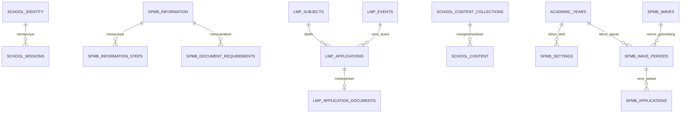

# Arsitektur backend dan normalisasi database

## Hasil audit

Sebelumnya repository generik tersedia, tetapi sebagian besar controller CMS, SPMB, dan LMP masih menggunakan DbContext langsung. Filter EF, transaksi, aturan pendaftaran, dan pemetaan respons bercampur dalam controller. Beberapa konfigurasi terstruktur disimpan sebagai satu JSON besar.

Sekarang alur modul aktif menjadi:



- **Domain**: entitas, model input, dan tipe data; tidak bergantung pada EF Core atau ASP.NET.
- **Application**: service konten, kontak, gambar, identitas sekolah, informasi SPMB, pendaftaran SPMB/LMP, dan pengguna. Hanya memiliki project reference ke Domain. Hasil service menggunakan `ResultKind`, bukan IActionResult atau objek HTTP.
- **Persistence**: implementasi repository, pengurutan/filter/pagination di SQL, pemetaan EF, transaksi, penguncian baris, dan penerjemahan exception database. Penyedia login/JWT berada di sini melalui kontrak `IAuthService` pada Application.
- **WebAPI**: routing, otorisasi, validasi format input, pembacaan multipart, respons/download, dan composition root DI. Controller aktif tidak memakai DbContext, IQueryable, atau SQL.

`IEntityRepository<T>` mengembalikan entitas/hasil proyeksi yang sudah dimaterialisasi, bukan IQueryable. Expression yang diberikan service tetap dieksekusi di SQL; count dan pagination tidak mengambil seluruh tabel ke memori. Repository khusus SPMB dan LMP menangani aggregate pendaftaran dan penguncian pengaturan.

Semua repository dan `IApplicationUnitOfWork` memakai DbContext scoped yang sama. Pengiriman formulir mengambil lock pengaturan **di dalam transaksi**, memeriksa jadwal/versi, menyimpan data, membuat nomor pendaftaran, lalu commit. Repository menolak lock tanpa transaksi. SubmissionKey unik menjaga idempotensi; Version menjaga konflik edit. Exception konkurensi/duplikat diterjemahkan ke tipe Application, bukan dibiarkan sebagai ketergantungan EF pada service.

Backend hanya berisi modul sekolah dan autentikasi. Project, assembly, namespace, dan DbContext menggunakan nama Cendekia. Pemeriksaan arsitektur mengikuti allowlist `CmsControllerFeatureProvider` dan memeriksa seluruh controller yang dikompilasi.

Dashboard dijalankan dari `cendekia-dashboard/Frontend`, dengan tracing root eksplisit untuk monorepo. Script dev/build memakai Webpack dan konfigurasi SVG yang sudah tersedia; ini menghindari kegagalan worker Turbopack yang ditemukan saat verifikasi pada Windows. Website publik tetap aplikasi terpisah pada `package`.

## Skema relasional



| Data | Penyimpanan aktif |
| --- | --- |
| Visi dan motto | Kolom pada `school_identity` |
| Poin misi berurutan | `school_missions`, FK IdentityId, posisi unik per identitas |
| Informasi/biaya/rekening SPMB | Kolom bertipe pada `spmb_information` |
| Tahap SPMB | `spmb_information_steps`, FK InformationId, posisi unik |
| Berkas baru/pindahan | `spmb_document_requirements`, FK InformationId, tipe peserta dan posisi unik |
| Pengaturan LMP | Kolom bertipe pada `lmp_settings`; tanggal DATE, biaya INT, sakelar BOOLEAN |
| Mata pelajaran LMP | Master `lmp_subjects`; satu SubjectId dengan FK pada setiap peserta |
| PDF peserta | Relasi opsional satu-ke-satu `lmp_application_documents`, FK/PK ApplicationId |
| Tahun ajaran | Master `academic_years`; FK dari pengaturan dan periode SPMB |
| Riwayat jadwal SPMB | `spmb_wave_periods`, PK gabungan AcademicYear/WaveNumber/Revision; FK gabungan dari pendaftar |
| Riwayat acara LMP | `lmp_events`; FK EventId pada pendaftar, judul/tanggal/biaya tidak disalin per peserta |
| Koleksi CMS | Master kode `school_content_collections` dan FK pada `school_content` |

Target desain adalah relasional hingga 3NF untuk data operasional terstruktur: kelompok berulang menjadi tabel anak, master mata pelajaran dipisahkan, foreign key mencegah referensi tidak valid, dan unique/check constraints menjaga posisi, kelas, status, biaya, serta rentang tanggal. Kolom ConfigJson/MissionsJson dan Subjects lama tidak lagi berada pada tabel operasional. EF owned types memetakan konfigurasi ke kolom biasa, **bukan** JSON.

Kontak website dengan satu nomor/email per sekolah dan kategori konten berupa label bebas tidak perlu dipecah menjadi banyak tabel tanpa kebutuhan. Isi artikel tetap teks; paragraf artikel bukan kelompok entitas berulang.

Ada dua keputusan yang disengaja:

1. **Riwayat pendaftaran menggunakan relasi ke fakta historis yang immutable.** Tahun, nomor gelombang dan revisi merupakan composite foreign key ke `spmb_wave_periods`; tanggal disimpan sekali pada periode tersebut. Kunci gabungan membuat tahun/gelombang/revisi tidak dapat saling bertentangan sekaligus mempertahankan unique `(AcademicYear,Nisn)` di pendaftar. Judul, tanggal dan biaya LMP disimpan sekali pada `lmp_events`, dirujuk lewat `EventId`. Perubahan pengaturan membuat periode/acara historis baru ketika ada pendaftaran; baris lama tidak diperbarui. Trigger menolak UPDATE fakta historis dan FK menolak penghapusan jika masih dipakai. Nama asal sekolah dan kontak tetap fakta isian formulir; kesamaan teks bukan bukti identitas sekolah/orang yang sama dan tidak digunakan untuk menggabungkan data pribadi secara otomatis.
2. **PDF dipisahkan untuk akses dan performa.** BLOB dalam baris peserta sebelumnya bukan otomatis pelanggaran 1NF; pemisahan vertikal mencegah pemuatan berkas saat daftar/status dibaca. PDF hanya diambil lewat endpoint staf yang terotorisasi. Berkas tidak menjadi URL publik.

Index mendukung slug per koleksi, publikasi terbaru, pencarian/filter peserta, dan submission key unik. Semua urutan publik/admin yang sudah disepakati tetap dipertahankan.

## Migrasi dan pemulihan

Sumber skema adalah SQL berversi, bukan EnsureCreated atau EF auto-migration. File migrasi berurutan: `database/migrations/20261106_school_normalization.sql`, kemudian `database/migrations/20261106_registration_relations.sql`. Runner menjalankan keduanya secara otomatis.

Untuk database yang sudah berjalan:

1. Hentikan API versi lama agar tidak menulis konfigurasi JSON selama migrasi.
2. Jalankan `powershell -NoProfile -File scripts/Backup-LocalDatabase.ps1` dari folder dashboard. Backup disimpan di `.verify-cms/backups`, diabaikan Git.
3. Jalankan `powershell -NoProfile -File scripts/init-local-db.ps1 -NormalizeOnly`. Runner juga otomatis membuat backup jika menemukan kolom JSON legacy.
4. Jalankan API versi baru dan pengujian di bawah.

Migrasi menggunakan advisory lock agar dua migrasi tidak berjalan bersamaan. Payload JSON asli diarsipkan sekali pada `schema_legacy_payloads`. Daftar diurai menjadi baris berurutan, mata pelajaran dipetakan ke FK, dan PDF disalin serta diperiksa hash-nya. Jumlah misi/tahap/persyaratan diverifikasi sebelum migration version dicatat. Cleanup kolom lama bisa dilanjutkan dengan menjalankan migrasi lagi. Setup ulang tidak memasukkan seed JSON ke tabel yang sudah dimigrasikan.

MySQL melakukan implicit commit untuk DDL: rangkaian perubahan struktur **bukan satu transaksi yang dapat di-rollback penuh**. Karena itu backup wajib tersedia; backup utuh digunakan untuk pemulihan jika diperlukan. Jangan menjalankan API lama terhadap skema baru. `schema_legacy_payloads` adalah arsip migrasi, bukan sumber data aktif. Backup berisi data privat dan tidak boleh dipush ke GitHub.

Untuk instalasi kosong, gunakan `scripts/init-local-db.ps1` seperti biasa. Baseline dan seed kompatibilitas dijalankan dahulu, kemudian migrasi ke skema relasional langsung diterapkan. SQL baseline lama yang masih memuat JSON tidak dijalankan ulang pada instalasi yang sudah dinormalisasi.

## Validasi

```powershell
dotnet build Backend/Cendekia.sln
node scripts/check-architecture.mjs
node scripts/check-normalization.mjs
node scripts/check-registration-relations.mjs
node scripts/check-cms.mjs
node scripts/check-contact-settings.mjs
node scripts/check-homepage-images.mjs
node scripts/check-school-identity.mjs
node scripts/check-spmb-information.mjs
node scripts/check-lmp.mjs
$env:SPMB_ALLOW_TEST_SETUP = '1'
node scripts/check-spmb.mjs
node scripts/check-social-feeds.mjs
```

Suite SPMB membuat SQL cleanup dengan submission key khusus di `.verify-cms/spmb-test-cleanup.sql`; jalankan cleanup itu setelah tes. Suite pengaturan memulihkan nilai awal dan suite LMP membersihkan peserta uji miliknya. Pengujian browser opsional memakai `LMP_BROWSER_CHECK=1` / `SPMB_BROWSER_CHECK=1` dan dependensi Playwright pada direktori verifikasi lokal.

Validasi implementasi mencakup perbandingan respons sembilan endpoint sebelum/sesudah migrasi, setup dari kosong pada instance MySQL terpisah, setup/migrasi ulang, penolakan FK/posisi duplikat/tanggal/biaya tidak valid, login dan role, CRUD CMS, konflik edit, idempotensi pendaftaran, jadwal WIB, snapshot historis, download PDF privat, dan alur formulir–admin desktop/mobile. UI serta kontrak API tetap kompatibel.

## Normalisasi relasi pendaftaran v2

Jalankan `scripts/init-local-db.ps1 -NormalizeOnly` setelah menghentikan API. Runner membuat backup jika masih menemukan kolom snapshot lama. Migrasi mengelompokkan jadwal/acara historis, mengisi FK, membandingkan kembali setiap fakta dengan nilai lama, lalu menghapus kolom tanggal SPMB serta judul/tanggal/biaya LMP yang berulang. Pendaftar, nomor registrasi, PDF, status, dan unique NISN per tahun tetap dipertahankan. Kolom `CompetitionDateKey` pada acara adalah generated key untuk menjamin uniqueness meskipun tanggal belum ditentukan; bukan data yang diedit terpisah.

API tetap mengirim `waveStartDate`, `waveEndDate`, `eventTitle`, `competitionDate`, dan `feeAmount` dengan mengambilnya dari relasi. Tidak ada perubahan kontrak formulir/dashboard. Jadwal aktif tetap memiliki tepat empat gelombang. Riwayat tidak menunjuk ke tanggal pengaturan yang bisa berubah. Transaksi submit mengunci pengaturan sebelum mencari/membuat versi historis, sehingga concurrent retry tidak membuat baris versi atau pendaftaran ganda.

Verifikasi v2 mencakup fingerprint seluruh riwayat sebelum/sesudah, migrasi ulang, bootstrap kosong dan seed dummy berulang pada MySQL terpisah, pemulihan backup pra-v2, migrasi acara bertanggal NULL, penolakan FK/composite key tidak valid, larangan update/penghapusan riwayat yang digunakan, serta integrasi API SPMB/LMP dan CMS. `check-registration-relations.mjs` menggunakan transaksi terpisah dan rollback untuk fixture pengujian constraint.
