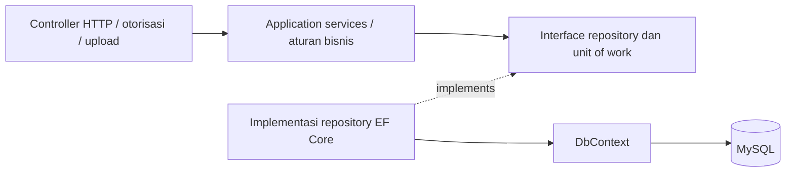
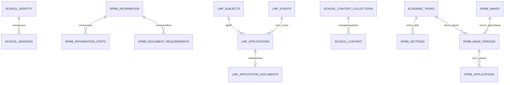

# Arsitektur backend dan normalisasi database

## Hasil audit

Sebelumnya repository generik tersedia, tetapi sebagian besar controller CMS, SPMB, dan LMP masih menggunakan DbContext langsung. Filter EF, transaksi, aturan pendaftaran, dan pemetaan respons bercampur dalam controller. Beberapa konfigurasi terstruktur disimpan sebagai satu JSON besar.

Sekarang alur modul aktif menjadi:



- **Domain**: entitas, model input, dan tipe data; tidak bergantung pada EF Core atau ASP.NET.
- **Application**: service konten, kontak, gambar, identitas sekolah, informasi SPMB, pendaftaran SPMB/LMP, dan pengguna. Hanya memiliki project reference ke Domain. Hasil service menggunakan `ResultKind`, bukan IActionResult atau objek HTTP.
- **Persistence**: implementasi repository, pengurutan/filter/pagination di SQL, pemetaan EF, transaksi, penguncian baris, dan penerjemahan exception database. Penyedia login/JWT berada di sini melalui kontrak `IAuthService` pada Application.
- **WebAPI**: routing, otorisasi, validasi format input, pembacaan multipart, respons/download, dan composition root DI. Controller aktif tidak memakai DbContext, IQueryable, atau SQL.

`IEntityRepository<T>` mengembalikan entitas/hasil proyeksi yang sudah dimaterialisasi, bukan IQueryable. Expression yang diberikan service tetap dieksekusi di SQL; count dan pagination tidak mengambil seluruh tabel ke memori. Repository khusus SPMB dan LMP menangani aggregate pendaftaran dan penguncian pengaturan.

Semua repository dan `IApplicationUnitOfWork` memakai DbContext scoped yang sama. Pengiriman formulir mengambil lock pengaturan **di dalam transaksi**, memeriksa jadwal/versi, menyimpan data, membuat nomor pendaftaran, lalu commit. Repository menolak lock tanpa transaksi. SubmissionKey unik menjaga idempotensi; Version menjaga konflik edit. Exception konkurensi/duplikat diterjemahkan ke tipe Application, bukan dibiarkan sebagai ketergantungan EF pada service.

Backend hanya berisi modul sekolah dan autentikasi. Project, assembly, namespace, dan DbContext menggunakan nama Cendekia. Pemeriksaan arsitektur mengikuti allowlist `CmsControllerFeatureProvider` dan memeriksa seluruh controller yang dikompilasi.

Dashboard dijalankan dari `cendekia-dashboard/Frontend`, dengan tracing root eksplisit untuk monorepo. Script dev/build memakai Webpack dan konfigurasi SVG yang sudah tersedia; ini menghindari kegagalan worker Turbopack yang ditemukan saat verifikasi pada Windows. Website publik tetap aplikasi terpisah pada `package`.

## Skema relasional



| Data | Penyimpanan aktif |
| --- | --- |
| Visi dan motto | Kolom pada `school_identity` |
| Poin misi berurutan | `school_missions`, FK IdentityId, posisi unik per identitas |
| Informasi/biaya/rekening SPMB | Kolom bertipe pada `spmb_information` |
| Tahap SPMB | `spmb_information_steps`, FK InformationId, posisi unik |
| Berkas baru/pindahan | `spmb_document_requirements`, FK InformationId, tipe peserta dan posisi unik |
| Pengaturan LMP | Kolom bertipe pada `lmp_settings`; tanggal DATE, biaya INT, sakelar BOOLEAN |
| Mata pelajaran LMP | Master `lmp_subjects`; satu SubjectId dengan FK pada setiap peserta |
| PDF peserta | Relasi opsional satu-ke-satu `lmp_application_documents`, FK/PK ApplicationId |
| Tahun ajaran | Master `academic_years`; FK dari pengaturan dan periode SPMB |
| Riwayat jadwal SPMB | `spmb_wave_periods`, PK gabungan AcademicYear/WaveNumber/Revision; FK gabungan dari pendaftar |
| Riwayat acara LMP | `lmp_events`; FK EventId pada pendaftar, judul/tanggal/biaya tidak disalin per peserta |
| Koleksi CMS | Master kode `school_content_collections` dan FK pada `school_content` |

Target desain adalah relasional hingga 3NF untuk data operasional terstruktur: kelompok berulang menjadi tabel anak, master mata pelajaran dipisahkan, foreign key mencegah referensi tidak valid, dan unique/check constraints menjaga posisi, kelas, status, biaya, serta rentang tanggal. Kolom ConfigJson/MissionsJson dan Subjects lama tidak lagi berada pada tabel operasional. EF owned types memetakan konfigurasi ke kolom biasa, **bukan** JSON.

Kontak website dengan satu nomor/email per sekolah dan kategori konten berupa label bebas tidak perlu dipecah menjadi banyak tabel tanpa kebutuhan. Isi artikel tetap teks; paragraf artikel bukan kelompok entitas berulang.

Ada dua keputusan yang disengaja:

1. **Riwayat pendaftaran menggunakan relasi ke fakta historis yang immutable.** Tahun, nomor gelombang dan revisi merupakan composite foreign key ke `spmb_wave_periods`; tanggal disimpan sekali pada periode tersebut. Kunci gabungan membuat tahun/gelombang/revisi tidak dapat saling bertentangan sekaligus mempertahankan unique `(AcademicYear,Nisn)` di pendaftar. Judul, tanggal dan biaya LMP disimpan sekali pada `lmp_events`, dirujuk lewat `EventId`. Perubahan pengaturan membuat periode/acara historis baru ketika ada pendaftaran; baris lama tidak diperbarui. Trigger menolak UPDATE fakta historis dan FK menolak penghapusan jika masih dipakai. Nama asal sekolah dan kontak tetap fakta isian formulir; kesamaan teks bukan bukti identitas sekolah/orang yang sama dan tidak digunakan untuk menggabungkan data pribadi secara otomatis.
2. **PDF dipisahkan untuk akses dan performa.** BLOB dalam baris peserta sebelumnya bukan otomatis pelanggaran 1NF; pemisahan vertikal mencegah pemuatan berkas saat daftar/status dibaca. PDF hanya diambil lewat endpoint staf yang terotorisasi. Berkas tidak menjadi URL publik.

Index mendukung slug per koleksi, publikasi terbaru, pencarian/filter peserta, dan submission key unik. Semua urutan publik/admin yang sudah disepakati tetap dipertahankan.

## Migrasi dan pemulihan

Sumber skema adalah SQL berversi, bukan EnsureCreated atau EF auto-migration. File migrasi berurutan: `database/migrations/20261106_school_normalization.sql`, kemudian `database/migrations/20261106_registration_relations.sql`. Runner menjalankan keduanya secara otomatis.

Untuk database yang sudah berjalan:

1. Hentikan API versi lama agar tidak menulis konfigurasi JSON selama migrasi.
2. Jalankan `powershell -NoProfile -File scripts/Backup-LocalDatabase.ps1` dari folder dashboard. Backup disimpan di `.verify-cms/backups`, diabaikan Git.
3. Jalankan `powershell -NoProfile -File scripts/init-local-db.ps1 -NormalizeOnly`. Runner juga otomatis membuat backup jika menemukan kolom JSON legacy.
4. Jalankan API versi baru dan pengujian di bawah.

Migrasi menggunakan advisory lock agar dua migrasi tidak berjalan bersamaan. Payload JSON asli diarsipkan sekali pada `schema_legacy_payloads`. Daftar diurai menjadi baris berurutan, mata pelajaran dipetakan ke FK, dan PDF disalin serta diperiksa hash-nya. Jumlah misi/tahap/persyaratan diverifikasi sebelum migration version dicatat. Cleanup kolom lama bisa dilanjutkan dengan menjalankan migrasi lagi. Setup ulang tidak memasukkan seed JSON ke tabel yang sudah dimigrasikan.

MySQL melakukan implicit commit untuk DDL: rangkaian perubahan struktur **bukan satu transaksi yang dapat di-rollback penuh**. Karena itu backup wajib tersedia; backup utuh digunakan untuk pemulihan jika diperlukan. Jangan menjalankan API lama terhadap skema baru. `schema_legacy_payloads` adalah arsip migrasi, bukan sumber data aktif. Backup berisi data privat dan tidak boleh dipush ke GitHub.

Untuk instalasi kosong, gunakan `scripts/init-local-db.ps1` seperti biasa. Baseline dan seed kompatibilitas dijalankan dahulu, kemudian migrasi ke skema relasional langsung diterapkan. SQL baseline lama yang masih memuat JSON tidak dijalankan ulang pada instalasi yang sudah dinormalisasi.

## Validasi

```powershell
dotnet build Backend/Cendekia.sln
node scripts/check-architecture.mjs
node scripts/check-normalization.mjs
node scripts/check-registration-relations.mjs
node scripts/check-cms.mjs
node scripts/check-contact-settings.mjs
node scripts/check-homepage-images.mjs
node scripts/check-school-identity.mjs
node scripts/check-spmb-information.mjs
node scripts/check-lmp.mjs
node scripts/check-payment-proofs.mjs
$env:SPMB_ALLOW_TEST_SETUP = '1'
node scripts/check-spmb.mjs
node scripts/check-social-feeds.mjs
```

Suite SPMB membuat SQL cleanup dengan submission key khusus di `.verify-cms/spmb-test-cleanup.sql`; jalankan cleanup itu setelah tes. Suite pengaturan memulihkan nilai awal dan suite LMP membersihkan peserta uji miliknya. Pengujian browser opsional memakai `LMP_BROWSER_CHECK=1` / `SPMB_BROWSER_CHECK=1` dan dependensi Playwright pada direktori verifikasi lokal.

Validasi implementasi mencakup perbandingan respons sembilan endpoint sebelum/sesudah migrasi, setup dari kosong pada instance MySQL terpisah, setup/migrasi ulang, penolakan FK/posisi duplikat/tanggal/biaya tidak valid, login dan role, CRUD CMS, konflik edit, idempotensi pendaftaran, jadwal WIB, snapshot historis, download PDF privat, dan alur formulir–admin desktop/mobile. UI serta kontrak API tetap kompatibel.

## Normalisasi relasi pendaftaran v2

Jalankan `scripts/init-local-db.ps1 -NormalizeOnly` setelah menghentikan API. Runner membuat backup jika masih menemukan kolom snapshot lama. Migrasi mengelompokkan jadwal/acara historis, mengisi FK, membandingkan kembali setiap fakta dengan nilai lama, lalu menghapus kolom tanggal SPMB serta judul/tanggal/biaya LMP yang berulang. Pendaftar, nomor registrasi, PDF, status, dan unique NISN per tahun tetap dipertahankan. Kolom `CompetitionDateKey` pada acara adalah generated key untuk menjamin uniqueness meskipun tanggal belum ditentukan; bukan data yang diedit terpisah.

API tetap mengirim `waveStartDate`, `waveEndDate`, `eventTitle`, `competitionDate`, dan `feeAmount` dengan mengambilnya dari relasi. Tidak ada perubahan kontrak formulir/dashboard. Jadwal aktif tetap memiliki tepat empat gelombang. Riwayat tidak menunjuk ke tanggal pengaturan yang bisa berubah. Transaksi submit mengunci pengaturan sebelum mencari/membuat versi historis, sehingga concurrent retry tidak membuat baris versi atau pendaftaran ganda.

Verifikasi v2 mencakup fingerprint seluruh riwayat sebelum/sesudah, migrasi ulang, bootstrap kosong dan seed dummy berulang pada MySQL terpisah, pemulihan backup pra-v2, migrasi acara bertanggal NULL, penolakan FK/composite key tidak valid, larangan update/penghapusan riwayat yang digunakan, serta integrasi API SPMB/LMP dan CMS. `check-registration-relations.mjs` menggunakan transaksi terpisah dan rollback untuk fixture pengujian constraint.

## Grup WhatsApp SPMB per gelombang

`spmb_wave_groups` menyimpan satu tautan undangan per `(AcademicYear, WaveNumber)` dengan FK ke tahun ajaran dan gelombang. Tautan dapat diperbarui tanpa mengubah periode jadwal historis. Pengaturan staf mengembalikan tautan; jadwal publik tidak mengungkap undangan. Bukti submit (termasuk retry idempoten) mengambil grup berdasarkan tahun dan gelombang pendaftaran, bukan gelombang yang sedang aktif. Tautan kosong menyembunyikan tombol gabung. Hanya undangan HTTPS `chat.whatsapp.com` diterima.

Upgrade lokal: backup dengan `scripts/Backup-LocalDatabase.ps1`, lalu jalankan `scripts/init-local-db.ps1 -NormalizeOnly`; runner menyertakan migrasi idempoten `20261107_spmb_wave_groups.sql`. Tidak ada tautan grup yang diisi otomatis.

SPMB memakai satu sakelar global `spmb_settings.Enabled`. Gelombang otomatis ditentukan oleh rentang tanggal lengkap (inklusif WIB); kedua tanggal kosong berarti belum dijadwalkan. Flag per gelombang tidak diterima/dipakai oleh API dan tidak tampil di admin. Kolom legacy `spmb_waves.Enabled` tetap dipertahankan untuk kompatibilitas constraint database dan diturunkan dari kelengkapan tanggal saat menyimpan.

## Bukti transfer pendaftaran SPMB dan LMP

Pendaftaran baru wajib menyertakan `TransferAccountName` (nama pemilik rekening pengirim, maksimal 150 karakter) dan berkas multipart `paymentProof` (JPG/JPEG, PNG, atau PDF; maksimal 1 MB). Pemeriksaan ekstensi dan signature berkas dilakukan pada Application service; nama dan bukti harus lengkap. Pengunggahan tidak otomatis mengubah status pembayaran atau penerimaan. Retry dengan SubmissionKey yang sama tetap mengembalikan data tersimpan.

Tabel `spmb_payment_proofs` dan `lmp_payment_proofs` berelasi satu-ke-satu ke pendaftaran melalui PK/FK `ApplicationId` dengan ON DELETE CASCADE. Nama rekening merupakan metadata bukti transfer, tidak disalin ke baris pendaftar. BLOB tidak di-auto-include; repository memisahkan pembacaan metadata dan konten berkas. Pendaftaran lama tetap valid tanpa baris bukti transfer. Detail staf menampilkan nama rekening dan ketersediaan bukti; konten hanya diunduh melalui endpoint staf `/api/{spmb|lmp}/applications/{id}/payment-proof`, dengan Content-Disposition attachment, no-store dan nosniff. Tidak ada URL berkas publik.

SPMB beralih ke multipart/form-data. LMP tetap memiliki berkas persyaratan PDF terpisah dari bukti transfer; bukti transfer maksimal 1 MB dan PDF persyaratan maksimal 2 MB. Batas total LMP/backend/reverse proxy menjadi sekitar 4,4 MB, SPMB 2,2 MB. Contoh Nginx telah diperbarui; sesuaikan `client_max_body_size 4400k` pada server untuk LMP dua berkas sebelum reload Nginx.

Upgrade: backup database, jalankan migrasi idempoten `database/migrations/20261108_registration_payment_proofs.sql` (juga disertakan runner `scripts/init-local-db.ps1 -NormalizeOnly`), lalu gunakan backend dan kedua frontend terbaru secara bersamaan. Tidak ada data pendaftar lama atau status pembayaran yang diubah migrasi ini.

### Optimasi ukuran bukti transfer gambar

Application memanggil kontrak `IRegistrationFileOptimizer`; implementasi SkiaSharp berada di Persistence. Optimasi dilakukan sebelum transaksi/row lock pendaftaran. JPG/PNG divalidasi melalui decoder, dikoreksi orientasi EXIF, diperkecil maksimal sisi panjang 2400 px, lalu dicoba JPEG kualitas 82 (78 bila masih di atas target 350 KB). Target bukan batas mutlak: kualitas teks tetap diprioritaskan. Hanya hasil yang lebih kecil dari unggahan yang disimpan; MIME dan ekstensi unduhan mengikuti hasil aktual. PNG kecil bisa tetap PNG. PDF bukti transfer dan PDF persyaratan LMP tidak ditulis ulang agar isi/tanda tangan tetap utuh.

Singleton semaphore membatasi satu kompresi gambar per proses API. Header dimensi diperiksa sebelum alokasi piksel, JPEG didekode dengan ukuran tersampel, dan buffer native dibuang setelah selesai. Maksimum piksel decode 12 juta; gambar yang tidak terbaca atau melebihi batas ditolak dengan pesan untuk mengecilkan resolusi. Cancellation request diteruskan saat menunggu giliran. Batas upload bukti transfer 1 MB tetap berlaku. Tidak ada migrasi SQL tambahan atau kompresi ulang otomatis terhadap data lama.

Uji `node scripts/check-file-optimizer.mjs` mencakup pengurangan ukuran JPEG nyata, PNG kecil, orientasi EXIF, PDF tidak berubah, penolakan gambar rusak/dimensi berlebihan, permintaan bersamaan, dan cancellation. Artefak fixture/harness tetap di `.verify-cms`.

### Laporan pendaftar XLSX

Dashboard SPMB/LMP menyediakan **Export XLSX** di bawah tombol pengaturan. Endpoint staf `GET /api/{spmb|lmp}/applications/export` memakai filter yang sama dengan daftar: SPMB `year/wave/status/search`; LMP `subject/grade/status/payment/search`. Ekspor selalu mencakup seluruh hasil filter, tidak dibatasi pagination layar, dan urutan terbaru tetap sama dengan daftar. Filter expression dipakai bersama dalam Application service; repository melakukan proyeksi data tanpa mengambil BLOB bukti transfer/dokumen.

Workbook dibuat di WebAPI melalui ClosedXML 0.105.1 (`Reports/XlsxReportWriter.cs`); Application tetap hanya menyusun data laporan melalui repository. Bagian atas memuat judul berlatar navy, jumlah pendaftar, waktu ekspor WIB, dan ringkasan filter/pencarian tanpa kop atau logo. Tabel mulai baris 6 dengan nomor urut, header biru, warna baris berselang, penekanan nama/nomor pendaftaran, warna status, tinggi baris sesuai isi, freeze hingga header, auto-filter dan lebar kolom. Cetak landscape satu halaman lebar, header tabel diulang di setiap halaman, serta footer nomor halaman tersedia. Identitas/kontak, status, tahun/gelombang SPMB atau acara/mapel/biaya LMP disertakan; waktu ditampilkan dalam WIB. Sel data disimpan sebagai teks sehingga NISN/telepon mempertahankan nol depan dan isian yang diawali `=` tidak menjadi formula. Download dilindungi role staf yang sama dengan daftar, `no-store`, dan `nosniff`; berkas bukti transfer tidak diekspor. Tidak ada perubahan SQL.

Verifikasi `node scripts/check-applicant-exports.mjs` memerlukan Python untuk memeriksa struktur ZIP/XML workbook dan membandingkan semua baris dengan hasil filter API. Kasus tanpa hasil tetap menghasilkan file dengan header.

### Tahapan pendaftaran LMP

Alur pada halaman publik `/lmp` mengikuti `config.steps` dari `/api/lmp/information`, disunting melalui `/lmp/informasi` di dashboard. Admin dapat menambah/menghapus 1?20 tahap, mengubah judul/penjelasan/ikon, menaikkan/menurunkan urutan, dan memilih satu tahap untuk menampilkan nominal biaya. Perubahan alur mengikuti validasi dan Version pengaturan LMP yang sama; transaksi/lock root tetap menjaga konsistensi.

Penyimpanan menggunakan `lmp_information_steps` dengan FK SettingsId, posisi unik 1?20, judul, deskripsi, ikon, serta ShowPayment. `LmpSettings.StepRecords` merupakan relasi anak, diambil repository; daftar DTO `LmpConfig.Steps` tidak dipetakan sebagai kolom atau JSON. Sinkronisasi memakai OrderedChildren agar urutan tidak berbenturan dengan unique key.

Backup database sebelum menjalankan `database/migrations/20261109_lmp_information_steps.sql` (juga disertakan runner NormalizeOnly), kemudian gunakan backend/frontend baru bersama. Migrasi mengisi lima tahap awal dari alur sebelumnya beserta petunjuk pembayaran/berkas saat migrasi; pengulangan migrasi tidak menimpa tahapan yang diedit. Deskripsi tahap berikutnya dikelola melalui editor alur; nominal biaya mengikuti FeeAmount. Tidak mengubah data pendaftar, periode lomba, atau jadwal pendaftaran.

Verifikasi: `node scripts/check-lmp-steps.mjs` menguji validasi, tambah/hapus/urutan 1?20, konflik versi, migrasi berulang, persistensi dan tampilan publik; pengaturan awal dipulihkan setelah pengujian.

### Berkas persyaratan SPMB: dibawa langsung dan arsip PDF lama

Per 10 November 2026, sesuai keputusan pengguna, formulir publik SPMB tidak memiliki input PDF persyaratan dan backend menerima pendaftaran tanpa `document`. Berkas dibawa langsung sesuai catatan persyaratan sekolah; form/receipt mengingatkan hal tersebut dan menautkan halaman informasi. Bukti transfer tetap wajib maksimal 1 MiB. Bagian pembayaran menjadi E setelah bagian upload dihapus. LMP tidak berubah.

Untuk kompatibilitas saat deploy, API masih menerima PDF opsional dari klien lama dengan validasi maksimal 1 MiB/ekstensi/header; validasi ini tidak dijalankan jika berkas tidak dikirim. Receipt tidak menganggap ketiadaan PDF sebagai kekurangan. Portal hanya menampilkan panel dokumen bila HasDocument=true. Endpoint staf `/api/spmb/applications/{id}/document` tetap mengirim arsip PDF sebagai attachment dengan no-store/nosniff; tidak tersedia URL berkas publik. Berkas lama tidak dihapus.

Dokumen disimpan melalui relasi satu-ke-satu `spmb_application_documents` (PK/FK ApplicationId, ON DELETE CASCADE), terpisah dari baris peserta dan tanpa AutoInclude BLOB. Sebelum transaksi database, implementasi IRegistrationFileOptimizer mengompres seluruh byte PDF menggunakan Brotli lossless, satu proses pada satu waktu melalui gate yang sama dengan optimasi gambar. Bila hasil tidak lebih kecil, simpan raw. Kolom Compression (`br`/`raw`) dan OriginalLength mendeskripsikan encoding penyimpanan; BLOB tidak selalu merupakan PDF langsung.

Repository merekonstruksi PDF saat diunduh staf, membatasi hasil hingga OriginalLength (maksimal 1 MiB), serta memeriksa panjangnya. Byte unduhan harus identik dengan PDF unggahan, sehingga kualitas gambar, isi teks, dan tanda tangan tidak ditulis ulang. Ini kompresi penyimpanan, bukan penurunan resolusi gambar dalam PDF. PDF yang sudah padat dapat menghemat sedikit atau tidak sama sekali. Dokumen lama, PDF bukti transfer dan berkas LMP tidak diubah oleh fitur ini. Batas total request SPMB 2,2 MB tetap cukup untuk PDF persyaratan dan bukti transfer yang masing-masing maksimal 1 MiB.

Tabel arsip menggunakan migrasi historis `database/migrations/20261109_spmb_application_documents.sql`; tidak ada migrasi baru untuk menghapus kewajiban unggahan. Deploy backend beserta website/admin bersama. `node scripts/check-spmb-documents.mjs` memverifikasi pendaftaran tanpa PDF, kompatibilitas unggahan opsional lama, kompresi/unduhan arsip dan otorisasi; `check-spmb.mjs` memeriksa submit web tanpa field document. `check-file-optimizer.mjs` tetap memverifikasi fallback raw untuk input yang tidak dapat diperkecil.

### Catatan persyaratan SPMB

`SpmbInformationConfig.DocumentNotes` merupakan teks opsional maksimal 2.000 karakter, disimpan pada kolom bertipe `spmb_information.DocumentNotes`, terpisah dari relasi `spmb_document_requirements`. Editor `/spmb/informasi` menyediakan kolom Catatan persyaratan sendiri. Website menampilkannya dalam kotak informasi di bawah dua daftar persyaratan, bukan item bullet. Baris baru dipertahankan, teks di-escape oleh React, dan kotak disembunyikan bila catatan kosong. Save menggunakan Version informasi SPMB yang sama.

Backup lalu jalankan `database/migrations/20261109_spmb_document_notes.sql` sebelum menggunakan backend terbaru. Runner NormalizeOnly juga menyertakannya. Migrasi menambahkan kolom secara idempoten dan memindahkan item lama dengan awalan `Catatan:` ke kolom catatan tanpa mengubah berkas lain. Item hanya dihapus setelah seluruh teksnya ada dalam catatan; bila total melewati 2.000 karakter, item lama dipertahankan. Bila belum ada catatan, isi awal adalah ?Berkas persyaratan dibawa pada saat daftar ulang.? Pengulangan migrasi tidak menimpa edit selanjutnya.

### Formulir SPMB lengkap

Formulir mengikuti referensi sekolah: email, nama lengkap/panggilan, tempat dan tanggal lahir, jenis kelamin, agama Islam, asal sekolah, NISN, alamat murid, riwayat penyakit opsional, tinggi (cm), berat (kg), golongan darah A/B/AB/O, nomor HP ayah/ibu, nama ayah/ibu/wali, pekerjaan ayah/ibu/wali, alamat orang tua/wali, kontak WhatsApp, keadaan ekonomi, bahasa sehari-hari opsional, serta pilihan murid baru/pindahan. Nama dan pekerjaan wali opsional; kosongkan bila tidak ada. Nilai kosong disimpan sebagai string kosong dan ditampilkan sebagai Tidak diisi pada ringkasan/detail. NISN dan email sekarang wajib bagi seluruh pendaftar baru. Email memakai field kontak GuardianEmail yang sudah tersedia; tidak ditambahkan email kedua. Tempat dan tanggal lahir tetap input terpisah agar tanggal dapat divalidasi melalui date picker.

Data profil tambahan disimpan di `spmb_applicant_profiles` (PK/FK ApplicationId, ON DELETE CASCADE), tanpa membuat data kesehatan/keluarga fiktif untuk pendaftaran lama. Root menyimpan identitas/kontak yang sudah ada; alamat murid dan alamat orang tua adalah fakta terpisah. Profil dibaca hanya pada receipt, detail staf dan proyeksi export; daftar pendaftar tidak memuat profil atau BLOB. Pilihan masuk sekolah tidak diduplikasi dalam database: VII berarti murid baru, VIII/IX pindahan, dengan validasi EntryType pada request.

Tinggi/berat dibatasi satu angka desimal, disimpan DECIMAL(5,1); binder decimal multipart membaca format invariant HTML (titik desimal) tanpa mengikuti locale server. API menolak angka di luar batas dan enum yang tidak dikenali. Receipt menampilkan ringkasan tambahan, detail admin menampilkan profil, dan XLSX menyertakan kolom tambahan. Laporan dengan lebih dari 24 kolom dicetak dua halaman lebar dengan nomor urut/pendaftaran diulang, agar teks lebih terbaca.

Backup lalu jalankan `database/migrations/20261109_spmb_applicant_profiles.sql` (runner NormalizeOnly juga menyertakannya). Deploy backend/public/admin bersama; data lama dan status pendaftaran tidak ditulis ulang. Bukti transfer maksimal 1 MiB tetap wajib; PDF persyaratan tidak lagi diminta pada formulir SPMB. Verifikasi `check-spmb.mjs` mencakup validasi profil/decimal, persistensi, pengiriman web dan detail dashboard; fixture tes ada di `scripts/lib/spmb-profile-fixture.mjs`.

### Embed profil TikTok pada beranda

Bagian TikTok di beranda memakai creator profile embed resmi untuk `https://www.tiktok.com/@smpitcendekiapurwakarta` melalui `TikTokProfile.tsx`, dengan bingkai yang mengikuti bagian Instagram. Script embed baru dimuat saat bagian mendekati viewport; container menyediakan skeleton, judul iframe, dan tombol menuju akun saat embed gagal. Script yang sudah dimuat dapat memproses markup baru ketika navigasi kembali ke beranda. Konten profil/video berasal langsung dari TikTok, bukan thumbnail koleksi CMS.

Koleksi CMS `tiktok` dan halaman `/tiktok` tetap tersedia untuk daftar postingan editorial; beranda tidak lagi meminta koleksi tersebut. Tidak ada perubahan SQL atau dependensi package. Verifikasi browser mencakup iframe creator asli, profil tujuan, layout desktop/390 px dan fallback saat script TikTok diblokir.

### Foto konten disimpan di database

Editor konten non-media-sosial menerima upload JPG/PNG maksimal 2 MiB. Backend memvalidasi signature dan decoding, membatasi resolusi/memori decode, memperbaiki orientasi EXIF, lalu mengecilkan foto hingga sisi 2400 px dengan kualitas 82/78. Target ukuran 350 KiB bersifat upaya optimasi, bukan jaminan; hasil hanya menggantikan berkas asli jika lebih kecil. Foto transparan mempertahankan alpha melalui WebP/PNG. Semaphore optimizer membatasi pemrosesan bitmap bersamaan. URL gambar lama tetap didukung; gambar eksternal tidak otomatis diunduh atau dimigrasikan.

`school_content_images` menyimpan MIME dan BLOB hasil kompresi, direferensikan FK unik nullable `school_content.ImageId`. Daftar/admin/dashboard/publik hanya mengambil metadata dan URL `/api/school/images/{guid}`, tanpa BLOB atau base64. Penggantian/penghapusan foto menghapus BLOB lama dalam transaksi SaveChanges yang sama; konflik slug/version tidak meninggalkan foto yatim. Alur tetap controller → Application → repository/unit of work → Persistence.

Endpoint gambar hanya melayani konten Published yang sudah mencapai tanggal terbit untuk publik; ADMIN/SUPERVISOR/OPERATOR dapat melihat foto draf. Proxy website publik hanya meneruskan endpoint tetap ini tanpa kredensial staf, dengan MIME allowlist dan `nosniff`. Respons gambar memakai no-store agar perubahan status tidak meninggalkan foto draf di cache publik.

Backup database dan jalankan `database/migrations/20261109_school_content_images.sql` sebelum backend baru; runner `scripts/init-local-db.ps1 -NormalizeOnly` juga menyertakannya. Migrasi idempotent tidak mengubah URL atau konten lama. Verifikasi: `node scripts/check-file-optimizer.mjs` dan `node scripts/check-content-images.mjs` (API 5243, website 3000, akun admin lokal); tes membuat dan membersihkan konten sementara.

### Cek status SPMB dan cetak bukti

Website `/spmb/cek-status` diakses dari tombol pada halaman `/spmb`. Pengguna mengirim nama lengkap dan NISN 10 digit melalui POST same-origin `/api/spmb/check-status`, diteruskan ke endpoint backend dengan path yang sama. Nama dicocokkan penuh tanpa membedakan kapital, dengan trim spasi tepi; tidak ada pencarian sebagian nama atau daftar hasil publik. Bila ada beberapa tahun pendaftaran yang cocok, hasil mengambil SubmittedAt terbaru (tie-break Id). Ketiadaan pasangan nama/NISN menghasilkan `found:false`, bukan membocorkan apakah salah satu field ada dalam database.

Application memakai proyeksi repository ke nomor/nama/NISN, sekolah asal, kelas, tahun/gelombang, waktu submit, status pendaftaran/pembayaran dan grup WhatsApp tahun/gelombang terkait. Data keluarga, alamat, kesehatan, rekening, SubmissionKey, Id internal, dan file tidak disertakan. Tidak ada penulisan saat lookup. POST dibatasi 2 KiB; endpoint memakai policy `registration-lookup` (default Production 10/IP/menit, override `RateLimits:RegistrationLookupsPerMinute`), no-store dan noindex. Nama/NISN tidak disimpan dalam URL/localStorage. Contoh nginx juga memasukkan rute lookup ke limiter edge; KnownProxies/TRUST_PROXY_HEADERS tetap harus benar.

Receipt SPMB/LMP dan hasil cek status menyediakan `PrintReceiptButton` yang memanggil dialog cetak browser, termasuk pilihan simpan PDF. `receipt-print.css` hanya mengisolasi `.registration-receipt` saat print: header/footer/form, tombol dan pengingat screenshot disembunyikan; nomor, detail, status, serta tautan grup tetap dicetak. Identitas sekolah dan judul bukti ditambahkan hanya pada cetakan. Status Baru/Diproses dibedakan dari penerimaan dan pembayaran.

Verifikasi lokal: `SPMB_ALLOW_TEST_SETUP=1 CMS_BROWSER_CHECK=1 node scripts/check-spmb-lookup.mjs` (API 5243, website 3000, dashboard 3002, Playwright pada `.verify-cms`). Tes membuat lalu membersihkan aplikasi sintetis, memeriksa kecocokan/penolakan input, status terbaru, batas field publik, proxy, UI, tampilan HP dan PDF. Deploy API, website dan dashboard bersama; status pembayaran memerlukan migrasi di bawah.

### Status pembayaran SPMB

`spmb_applications.PaymentStatus` menyimpan fakta verifikasi staf yang independen dari `Status` penerimaan. Nilai mengikuti LMP: `Belum bayar` dan `Lunas`, dengan CHECK database dan validasi request. Upload bukti tidak mengubahnya menjadi Lunas; tidak ada auto-konfirmasi dari status Diterima. Data lama dimulai dari Belum bayar dan harus diperiksa staf bila sebelumnya sudah melunasi.

Portal menampilkan kolom/filter Pembayaran dan dropdown pada detail. Update status pendaftaran/pembayaran memakai Version yang sama, menolak perubahan basi dengan 409. Request lama tanpa PaymentStatus mempertahankan nilai saat ini. Daftar serta XLSX memakai predicate pembayaran yang sama; receipt dan cek status publik menampilkan status saja tanpa rekening atau dokumen privat.

Backup, hentikan API lama lalu terapkan `database/migrations/20261110_spmb_payment_status.sql` sebelum backend terbaru. Runner NormalizeOnly menyertakannya; migrasi idempotent tidak menulis ulang Status, Version atau data pendaftaran lainnya. Pemeriksaan mencakup constraint database, update staf/konkurensi/otorisasi, UI kolom/filter, export dan lookup publik melalui `check-spmb-lookup.mjs` serta `check-applicant-exports.mjs`.

### Pendaftaran dan cek status LMP dengan NISN

Pendaftaran LMP baru wajib memakai NISN 10 digit. Nilainya disimpan sebagai string pada `lmp_applications.Nisn`, sehingga angka nol di awal tetap utuh. Kolom nullable menjaga pendaftaran lama tanpa mengisi NISN fiktif. Staf dapat melengkapi/mengoreksi NISN lewat detail peserta di portal, memakai otorisasi dan Version yang sama dengan update status. Request status lama tanpa Nisn mempertahankan nilai tersimpan. NISN ditampilkan pada receipt, detail portal, hasil cek status dan XLSX.

Tombol di `/lmp` membuka `/lmp/cek-status`. POST same-origin `/api/lmp/check-status` memerlukan nama lengkap + NISN, pencocokan penuh/trim/case-insensitive untuk nama dan sama persis untuk NISN. Tidak ada pencarian berdasarkan nama saja. Data lama dengan Nisn NULL tidak cocok sampai staf melengkapinya. Endpoint tetap memakai batas 2 KiB, policy registration-lookup, no-store/noindex, tanpa nama/NISN dalam URL atau localStorage.

Service memproyeksikan maksimal 20 pendaftaran untuk pasangan nama/NISN, terbaru lebih dahulu. Beberapa pendaftaran peserta yang sama dapat dibedakan lewat acara/mata pelajaran; tidak ada constraint unik NISN lintas acara. Respons tidak memuat kontak guru, rekening, file, SubmissionKey atau Id internal. Hasil mencakup status pendaftaran/pembayaran, acara historis dan grup WhatsApp; hanya hasil pilihan yang dicetak.

Backup dan hentikan API, lalu terapkan `database/migrations/20261110_lmp_nisn.sql` sebelum backend/public/portal baru. Runner NormalizeOnly juga menyertakannya. Migrasi idempotent menambahkan kolom, index nonunik dan CHECK 10 digit tanpa mengubah catatan lama. Verifikasi lokal: `LMP_BROWSER_CHECK=1 node scripts/check-lmp.mjs` serta `LMP_ALLOW_TEST_SETUP=1 CMS_BROWSER_CHECK=1 node scripts/check-lmp-lookup.mjs`. Keduanya memakai dan membersihkan data sintetis sendiri, menguji validasi NISN/nol awal, penyimpanan, pasangan nama/NISN, legacy NULL, pembaruan staf/Version, batas field publik, proxy dan cetak.

### Standar huruf kapital pada pendaftaran baru

Form SPMB/LMP memakai handler `registration-uppercase.ts` dengan allowlist nama field untuk mengubah isian teks menjadi kapital saat diketik/ditempel, mempertahankan posisi kursor serta menunggu composition selesai. Nama murid/peserta, panggilan, sekolah, tempat lahir, nama keluarga/guru, alamat, pekerjaan, catatan kesehatan/bahasa, dan nama rekening pengirim mengikuti standar ini. Nilai asli email, nomor/NISN, angka/tanggal, berkas, dan enum pilihan tidak diubah. Tampilan bukan sekadar CSS uppercase: value input dan payload mengikuti hasil normalisasi.

Application menggunakan `RegistrationText.Upper` ketika membentuk entitas peserta/profil/bukti transfer, sehingga kiriman langsung ke API juga disimpan kapital. Receipt, portal, export dan lookup membaca data tersimpan yang sama. Pencarian status tetap tidak membedakan kapital. Tidak ada migrasi SQL atau penulisan ulang catatan historis; aturan berlaku pada pendaftaran baru. `check-spmb.mjs` / `check-lmp.mjs` memeriksa input browser dan receipt/DB-backed detail untuk huruf kapital, serta menjaga enum, email, nomor dan berkas.

### Foto dan halaman detail ekstrakurikuler

Koleksi `ekstrakurikuler` menampilkan kartu foto yang seluruhnya menautkan `/ekstrakurikuler/[slug]`. Halaman detail memakai judul kegiatan, ringkasan, nama pelatih/pembina dan paragraf kegiatan/latihan. Foto dapat diunggah dari editor CMS dan tetap dikompres sebelum disimpan ke BLOB `school_content_images`. Jika belum ada foto, website menampilkan placeholder teks, tanpa mengarang foto/nama pelatih. Detail hanya membaca koleksi publik yang sudah terbit; slug draf/terhapus/tidak dikenal menghasilkan 404. Koleksi kosong tidak menghidupkan kembali data template.

`school_content.CoachName` adalah atribut teks nullable maksimal 200 karakter khusus kegiatan ekskul; Category tetap kategori kegiatan. Body menyimpan narasi latihan, termasuk jadwal bila sudah tersedia. Request lama yang tidak menyertakan CoachName mempertahankan nilai tersimpan. Form portal menyediakan field pelatih dan label Kegiatan dan latihan. Tidak ada HTML mentah dari narasi CMS.

Backup lalu jalankan `database/migrations/20261110_extracurricular_coach.sql` sebelum backend/public/portal baru; runner NormalizeOnly juga menyertakannya. Migrasi berulang tidak mengubah data lama. Verifikasi `node scripts/check-extracurricular.mjs` menguji penyimpanan/validasi nama pelatih, unggah foto terkompres, route detail/publikasi, editor portal dan layout mobile.
